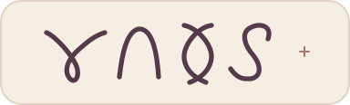

# Laiu



**Ла·и·у** — искусственный язык с короткими словами, выразительной долготой гласных и собственной письменностью. В основе слов лежат образы природы, движения и связи.

[](https://github.com/landiunload/Laiu/actions/workflows/checks.yml)

> **`а ми ки ин тив эм?`** — хочешь погулять в саду?  
> **`ла, ии ки лу ин тив.`** — да, мы погуляем в саду.

## Принцип

В слоге **CV** согласная передаёт образ, а гласная — его фазу. В слове `но` («спать») `н` связано с ночью, а `о` — с угасанием и покоем. Повтор гласной меняет длительность и может менять смысл. На письме повтор отмечает дуга над знаком.

| | С чего начать |
| --- | --- |
| **Говорить** | [Первый разговор](<Разговор в саду.md>) · [Произношение](Фонология.md) · [Фоносемантика](Фоносемантика.md) |
| **Читать и писать** | [Грамматика](Грамматика.md) · [Словарь](Лексика.md) · [Числа](Числа.md) · [Алфавит и шрифты](Письменность.md) |
| **Проверять** | [Разбор сложных фраз](<Проверка синтаксиса.md>) · [Формальный анализ](<Формальный анализ.md>) · [Исходники Lean](Lean) |

## Проверки

Проект проверяет уникальность словарных форм, запись чисел и знаков, глубину относительных ссылок, область действия операторов и краткость в формализованных фразах. Отдельно сверяются примеры справочника и работа шрифтов.

```sh
cd Lean
lake --wfail build
lake env lean ProofAudit.lean
lake env lean --run Audit.lean
```

Сборка использует [Elan](https://github.com/leanprover/elan) и версию из [lean-toolchain](Lean/lean-toolchain). Проверки [ссылок](checks/check_docs.py) и [шрифтов](checks/check_fonts.py) запускаются в GitHub Actions.

Для Obsidian открой корень репозитория как хранилище. Обзор разделов есть на [карте](canvas.canvas).
