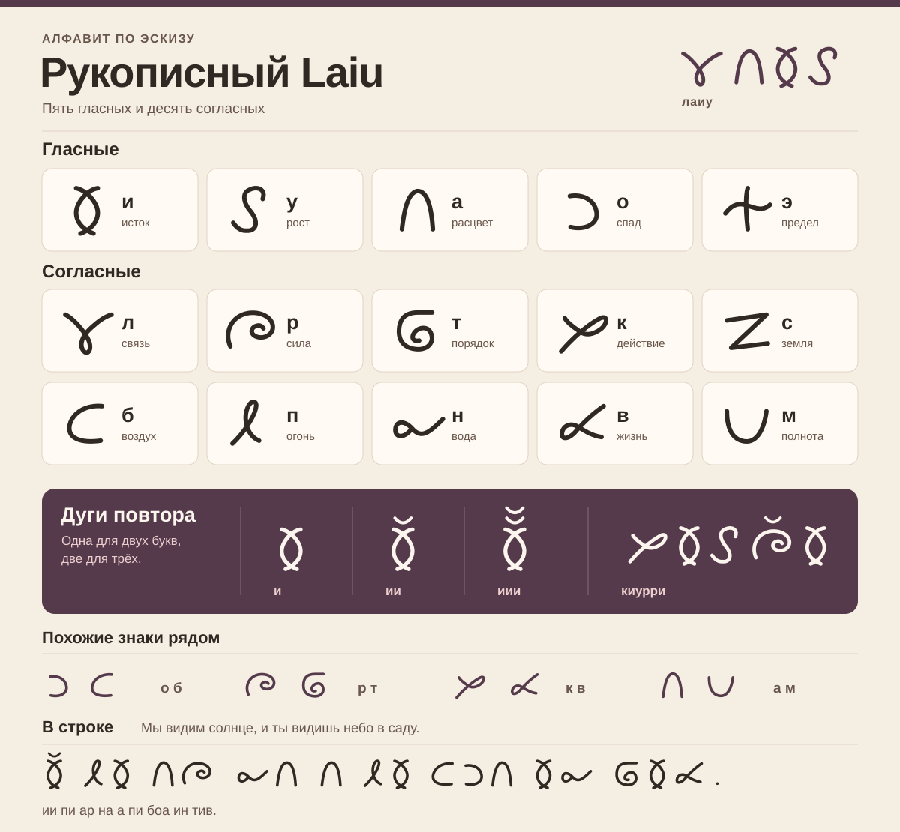

# Письменность Laiu

[[README|Laiu]] · [[Фонология]] · [[Фоносемантика]]

Письмо идёт слева направо. У каждого из пятнадцати звуков свой знак. Между словами оставляют пробел, а для пауз и вопросов используют привычную пунктуацию.

## Рукописный вариант

В рукописном начертании `а` — простая арка, а `и` — вытянутое зерно с перекрёстами на концах. У `к` петля поднята, у `в` она лежит ниже. Внизу таблицы близкие по форме знаки стоят рядом, чтобы их было удобнее сравнить.

[[Письмо/Алфавит.svg|Первый векторный эскиз для сравнения]]

## Повтор звука

Короткий хвостик над знаком рисуется дугой, как над «й». Одна дуга означает два одинаковых звука подряд, две дуги друг над другом — три. Хвостик относится к знаку под ним.

> [!example] Где ставить хвостик
> **`и` · `ии` · `иии`** — один и тот же знак без дуги, с одной или с двумя. Последний вариант показывает тройную гласную, как в начале `иииу` («чрезвычайно»).  
> **`киив`** — одна дуга над знаком `и`, даже на стыке корня и суффикса.  
> **`киурри`** — одна дуга над согласной `р`.  
> **`и иит`** — пробел отделяет короткое `и` от знака `и` с дугой в `иит`.  
> **`ув ул`** («новее») — отдельное слово степени и признак. **`уул`** («самый новый») — один начальный знак `у` с дугой.

Для разных соседних звуков нужны отдельные знаки. В `боа` записываются три знака, а в `лаиу` — четыре. [[Фонология#Долгота|Долгота]] · [[Фонология#Границы слов|Границы слов]]

## Как форма связана со звуком

В рукописном варианте **и** сохраняет форму зерна. У **у** изгиб поднимается, высокая арка **а** напоминает вершину расцвета, а дуга **о** возвращается назад. У **э** волнистый штрих пересекает вертикальную границу.

| Согласная | Что изображает знак |
| --- | --- |
| **л** | Две линии сходятся в нижней петле. |
| **р** | Открытая спираль уходит внутрь, как движение скрытой силы. |
| **т** | Ровный верхний штрих и плотный нижний виток передают порядок. |
| **к** | Диагональный штрих набирает высоту и поворачивает в верхнюю петлю. |
| **с** | Наклонный срез связывает две почти горизонтальные линии, как слои земли. |
| **б** | Свод открывается вправо, оставляя пространство для воздуха. |
| **п** | Высокая узкая петля напоминает язычок пламени. |
| **н** | Небольшая петля переходит в волну. |
| **в** | Из низкой петли поднимается побег. |
| **м** | Чаша с открытым верхом обозначает полноту. |

## Как набрать текст

Для рукописных начертаний выбери шрифт [Laiu Hand](Письмо/LaiuHand.ttf). Для первого векторного эскиза есть [Laiu Script](Письмо/Laiu.ttf). Набирай знакомые кириллические буквы, пробелы и знаки препинания. Шрифт покажет знаки Laiu и поставит хвостики над двумя или тремя одинаковыми буквами подряд. Начертания прописной и строчной форм совпадают.
